### ¿Qué es una función?

Una función es un bloque de código que:
📥 recibe datos → ⚙️ realiza un procesamiento → 📤 devuelve un valor

> La diferencia importante con un bloque anónimo es que la función queda guardada en la base de datos y puede reutilizarse.

### Función vs procedimiento vs bloque anónimo

<table>
  <thead>
    <tr>
      <th>Característica</th>
      <th>Bloque anónimo</th>
      <th>Función</th>
      <th>Procedimiento</th>
    </tr>
  </thead>
  <tbody>
    <tr>
      <td>Se guarda en BD</td>
      <td>❌</td>
      <td>✅</td>
      <td>✅</td>
    </tr>
    <tr>
      <td>Devuelve un valor</td>
      <td>❌</td>
      <td>✅ Obligatorio</td>
      <td>❌</td>
    </tr>
    <tr>
      <td>Se puede llamar desde SQL</td>
      <td>❌</td>
      <td>✅ Con restricciones</td>
      <td>❌</td>
    </tr>
    <tr>
      <td>Se reutiliza</td>
      <td>❌</td>
      <td>✅</td>
      <td>✅</td>
    </tr>
    <tr>
      <td>Uso típico</td>
      <td>🧪 Probar</td>
      <td>🧮 Calcular</td>
      <td>⚙️ Ejecutar acciones</td>
    </tr>
  </tbody>
</table>

> una función normalmente calcula, formatea o valida, mientras que un procedimiento se utiliza más para registrar, actualizar u orquestar acciones.

PARA RECORDAR:

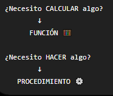

Por ejemplo:

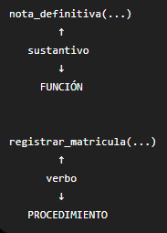

### Estructura de una función

La estructura básica es:

```sql
CREATE OR REPLACE FUNCTION nombre_funcion (
    parametros
)
RETURN tipo_de_dato
IS
    -- variables
BEGIN
    -- instrucciones

    RETURN valor;
END nombre_funcion;
/
```
EJEMPLO:

```sql
CREATE OR REPLACE FUNCTION fn_nota_definitiva (
    p_corte1 IN NUMBER,
    p_corte2 IN NUMBER,
    p_corte3 IN NUMBER DEFAULT 0
)
RETURN NUMBER
IS
    c_peso_final CONSTANT NUMBER := 0.4;
    v_nota NUMBER(3,2);
BEGIN
    v_nota := ROUND(
        p_corte1 * 0.3 +
        p_corte2 * 0.3 +
        p_corte3 * c_peso_final,
        2
    );

    RETURN v_nota;
END fn_nota_definitiva;
/
```

### Parámetros

Los parámetros son los datos que entran a la función.

significa:

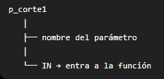


> Se recomienda utilizar parámetros IN, especialmente porque una función utilizada desde SQL necesita cumplir determinadas restricciones.

### Parámetros con DEFAULT
Podemos darle un valor predeterminado a un parámetro:

```sql
p_corte3 IN NUMBER DEFAULT 0
```
Eso significa:

> Si quien llama la función no proporciona p_corte3, Oracle utiliza 0.

EJEMPLO: 

```sql
fn_nota_definitiva(3.5, 4.0)
```
Oracle interpreta:

```text
p_corte1 = 3.5
p_corte2 = 4.0
p_corte3 = 0
```
> 📌 Regla: los parámetros que tienen DEFAULT deben ir al final.


### ¿Cómo llamamos una función?

1. Posicional

> El orden de los parámetros importa:
```sql
fn_nota_definitiva(3.5, 4.0, 2.8);
```
Oracle interpreta:

```text
3.5 → p_corte1
4.0 → p_corte2
2.8 → p_corte3
```

2. Notación nombrada

> Indicamos explícitamente qué valor corresponde a cada parámetro:
```sql
fn_nota_definitiva(
    p_corte1 => 3.5,
    p_corte2 => 4.0
);
```
> Esto es especialmente útil cuando queremos omitir parámetros que tienen DEFAULT.

3. Mixta
Primero parámetros posicionales y después nombrados:

```sql
fn_nota_definitiva(
    3.5,
    p_corte3 => 2.8,
    p_corte2 => 4.0
);
```

MAPA MENTAL: 

              LLAMAR FUNCIÓN
                    │
          ┌─────────┼─────────┐
          ▼         ▼         ▼
      Posicional  Nombrada   Mixta
          │         │         │
       importa    importa   primero
       el orden   el nombre posicional
                           ↓
                        nombrada


### RETURN
> Una función debe devolver un valor.


```sql
RETURN NUMBER ---> ¿Qué tipo de dato devuelve?
RETURN v_nota ---> ¿Qué valor devuelve?

```

NOTA:
```sql
RETURN NUMBER(3,2)
```
❌ No es correcto en la firma de la función.

DEBE SER:
```sql
RETURN NUMBER
```

### Toda ruta debe terminar en RETURN
```sql
IF p_nota >= 3 THEN
    RETURN 'APROBADO';
END IF;
```

¿Qué pasa si:
```sql
p_nota = 2.5
```
❓ No entra al IF.

Puede producir:
```text
ORA-06503
Function returned without a value
```
> esto ocurre en ejecución cuando una ruta termina sin ejecutar RETURN.

### ¿Dónde queda guardada la función?

Cuando hacemos:
```sql
CREATE OR REPLACE FUNCTION ...
```

Oracle guarda:
```text
📄 Código fuente
       +
⚙️ Código compilado
       ↓
🗄️ Base de datos
```
> La función puede incluso quedar en estado INVALID si tiene errores de compilación o si cambia una dependencia.

### ¿Qué significa que una función esté INVALID?

Si una funion utiliza la tabla estudiante y se modifica esa tabla, eso provoca que cambie por lo que la funcion queda INVALID. Oracle puede intentar recompilarla cuando se vuelva a utilizar.

Pero si la recompilación falla:

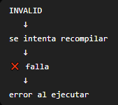

> Por eso es importante revisar el estado antes de asumir que todo está bien.

### ¿Cómo saber por qué no compila?

Después de crear una función:
```sql
SHOW ERRORS
```
También podemos consultar:
```sql
SELECT line, position, text
FROM user_errors
WHERE name = 'FN_NOTA_DEFINITIVA'
ORDER BY sequence;
```
Y revisar el estado:
```
SELECT object_name, status, last_ddl_time
FROM user_objects
WHERE object_type = 'FUNCTION';
```
> Hay que mirar estos errores en lugar de adivinar qué está fallando.

### ¿Dónde puedo utilizar una función?

Una función puede utilizarse:

🟢 Dentro de SQL
```sql
SELECT fn_nota_definitiva(c1, c2, c3)
FROM fn_nota;
```
🟢 Dentro de PL/SQL
```sql
v_definitiva :=
    fn_nota_definitiva(3.5, 4.0, 2.8);
```
🟢 Directamente para probarla
```
SELECT fn_nota_definitiva(3.5, 4.0, 2.8)
FROM dual;
```

### Una función dentro de un SELECT tiene un costo

si se tiene
```sql
SELECT fn_nota_definitiva(c1, c2, c3)
FROM fn_nota;
```
Si se tienen 100.000 filas 

Además, existe un cambio de contexto entre:

```text
🟦 Motor SQL
     ↕
🟧 Motor PL/SQL
```


IDEA CLAVE:

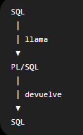

> Ese cambio repetido puede afectar el rendimiento.

### ¿Cuándo una función puede utilizarse desde SQL?

Debe:

✅ utilizar parámetros IN

✅ utilizar tipos de datos SQL

❌ no utilizar BOOLEAN, RECORD o colecciones PL/SQL como parámetros/retorno para esa llamada SQL

❌ no ejecutar determinadas operaciones como COMMIT, ROLLBACK o DDL dentro de la función invocada desde una consulta.

### DETERMINISTIC

```sql
DETERMINISTIC

```

significa que estamos prometiendo:

📌 Con las mismas entradas, la función siempre devuelve el mismo resultado.

EJEMPLO:
```sql
fn_limpia_nombre('isabela')
```
siempre debería devolver:
```text
ISABELA
```

EJEMPLO ESTRUCTURADO:
```sql
CREATE OR REPLACE FUNCTION fn_limpia_nombre (
    p_nombre IN VARCHAR2
)
RETURN VARCHAR2 DETERMINISTIC
IS
BEGIN
    RETURN UPPER(TRIM(p_nombre));
END;
/
```

### RESULT_CACHE

```sql
RESULT_CACHE
```

La idea:

Si ya calculé un resultado y puedo reutilizarlo, Oracle puede conservarlo en caché.

Visualmente

Sin caché:

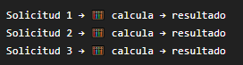

Con caché:

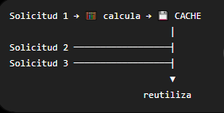

Es especialmente útil cuando tenemos datos que:
1. se consultan mucho
2. cambian poco
3. tienen resultados que vale la pena reutilizar

> Los cambios frecuentes en las tablas pueden invalidar las entradas del caché.

### PRAGMA UDF

El problema

```sql
SQL ↔ PL/SQL
```
Cuando una función se utiliza principalmente desde SQL, podemos utilizar:
```sql
PRAGMA UDF;
```

EJEMPLO:
```sql
CREATE OR REPLACE FUNCTION fn_iva(
    p_valor IN NUMBER
)
RETURN NUMBER
IS
    PRAGMA UDF;
BEGIN
    RETURN ROUND(p_valor * 0.19, 2);
END;
/
```
> PRAGMA UDF permite optimizar la función para invocaciones desde SQL.

### Excepciones dentro de funciones

Una función también puede manejar errores:

```sql
EXCEPTION
    WHEN NO_DATA_FOUND THEN
        RETURN NULL;

    WHEN TOO_MANY_ROWS THEN
        RAISE_APPLICATION_ERROR(
            -20001,
            'Identificador duplicado'
        );
```

Ejemplo conceptual:

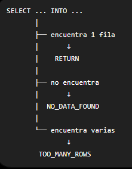

> NO_DATA_FOUND es como una excepción que debe manejarse explícitamente.

### AUTHID - ¿con qué privilegios se ejecuta?

Una función puede ejecutarse bajo diferentes privilegios.

1. AUTHID DEFINER

Es el valor predeterminado.

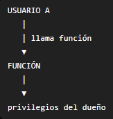

2. AUTHID CURRENT_USER

Utiliza los privilegios del usuario que está llamando.

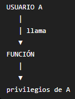

### Funciones dentro de paquetes

> Una función también puede formar parte de un PACKAGE.

Tenemos:

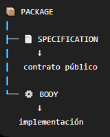

EJEMPLO:

```sql
CREATE OR REPLACE PACKAGE BODY pk_notas IS

    FUNCTION definitiva(
        p1 NUMBER,
        p2 NUMBER,
        p3 NUMBER
    ) RETURN NUMBER IS
    BEGIN
        RETURN ROUND(
            p1*.3 + p2*.3 + p3*.4,
            2
        );
    END;

END pk_notas;
/
```
> La ventaja es que podemos modificar la implementación sin afectar necesariamente a quienes dependen de la especificación.

### Errores frecuentes

<table>
  <thead>
    <tr>
      <th>Error</th>
      <th>¿Qué significa?</th>
      <th>Solución</th>
    </tr>
  </thead>
  <tbody>
    <tr>
      <td>PLS-00103</td>
      <td>Error de sintaxis</td>
      <td>Revisar declaración</td>
    </tr>
    <tr>
      <td>ORA-06503</td>
      <td>La función terminó sin RETURN</td>
      <td>Garantizar RETURN</td>
    </tr>
    <tr>
      <td>ORA-14551</td>
      <td>DML dentro de función usada desde SQL</td>
      <td>Revisar diseño</td>
    </tr>
    <tr>
      <td>INVALID</td>
      <td>El objeto necesita recompilarse</td>
      <td>Revisar dependencias</td>
    </tr>
    <tr>
      <td>Consulta lenta</td>
      <td>Función ejecutada muchas veces</td>
      <td>Considerar SQL puro / optimización</td>
    </tr>
  </tbody>
</table>

### MAPA MENTAL ESTRUCTURAL

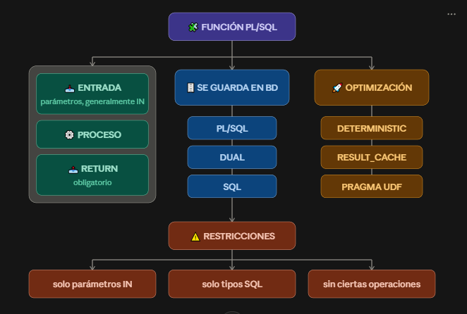

### idea final

FUNCIÓN
```sql
FUNCIÓN = recibe → procesa → devuelve
```

Diferencia con procedimiento
```sql
FUNCIÓN       → devuelve un valor 🧮
PROCEDIMIENTO → realiza una acción ⚙️
```

Estructura

```sql
CREATE OR REPLACE FUNCTION
...
RETURN tipo
IS
...
BEGIN
...
RETURN valor;
END;
/
```

REGLAS:
```text
✅ RETURN es obligatorio
✅ Una función devuelve un solo valor
✅ Parámetros IN para uso desde SQL
✅ RETURN NUMBER, no RETURN NUMBER(3,2)
✅ DEFAULT permite omitir un parámetro
✅ DEFAULT al final
✅ SHOW ERRORS ayuda a diagnosticar
```

Rendimiento:
```text
SQL → función → SQL
       ↕
   cambio de contexto
```

Si se ejecuta muchas veces:

```text
⚠️ puede ser costoso
```

> considerar primero SQL puro, y luego herramientas como PRAGMA UDF o RESULT_CACHE cuando correspondan.

### Preguntas teoricas


### Ejercicios practicos

Ejercicio 1. Calcular el doble

Crea una función llamada FN_DOBLE que reciba un número y devuelva el doble.

EJEMPLO:
Entrada 5 --> resultado 10

```sql
CREATE OR REPLACE FUNCTION FN_DOBLE(
VN_DATO IN NUMBER
) RETURN NUMBER IS
VN_CALCULAR_DOBLE  NUMBER:= 0;
BEGIN 

    VN_CALCULAR_DOBLE := VN_DATO * 2;
RETURN VN_CALCULAR_DOBLE;
END FN_DOBLE;
/
```

Ejercicio 2. Clasificar una nota

Crea una función llamada FN_CLASIFICAR_NOTA que reciba una nota y devuelva un texto según estas condiciones:

- Nota mayor o igual a 4.0: ALTO
- Nota mayor o igual a 3.0: MEDIO
- Nota menor a 3.0: BAJO

SOLUCION

```sql
CREATE OR REPLACE FUNCTION FN_CLASIFICAR_NOTA(
VN_NOTA IN NUMBER 
) RETURN VARCHAR2 IS
VV_TEXTO VARCHAR2(5);
BEGIN 
    IF VN_NOTA >= 4.0 THEN 
        VV_TEXTO := 'ALTO';
    ELSIF VN_NOTA >= 3.0 THEN 
        VV_TEXTO := 'MEDIO';
    ELSE 
        VV_TEXTO := 'BAJO';
    END IF;
    RETURN VV_TEXTO;
END;
/
```

Ejercicio 3. Calcular el salario anual

Crea una función llamada FN_SALARIO_ANUAL que reciba un salario mensual y devuelva el salario anual, suponiendo que recibe el mismo salario durante los 12 meses.

SOLUCION

```sql
CREATE OR REPLACE FUNCTION FN_SALARIO_ANUAL(
VN_SALARIO IN NUMBER
) RETURN NUMBER IS
BEGIN 
RETURN VN_SALARIO * 12;
END;
/
```

2. Funciones usando la base de datos HR

Ejercicio 4. Consultar el salario de un empleado

Crea una función llamada FN_CONSULTAR_SALARIO que reciba el EMPLOYEE_ID de un empleado y devuelva su salario consultando la tabla HR.EMPLOYEES.

SOLUCION
```sql
CREATE OR REPLACE FUNCTION FN_CONSULTAR_SALARIO(
VN_EMPLEADO_ID IN NUMBER
) RETURN NUMBER IS
VN_SALARIO NUMBER;
BEGIN
    SELECT E.SALARY 
        INTO VN_SALARIO
    FROM HR.EMPLOYEES E
    WHERE E.EMPLOYEE_ID = VN_EMPLEADO_ID;

    RETURN VN_SALARIO;
END;
/
```

Ejercicio 5. Obtener el nombre completo

Crea una función llamada FN_NOMBRE_EMPLEADO que reciba el identificador del empleado y devuelva su nombre completo, uniendo FIRST_NAME y LAST_NAME.

SOLUCION

```sql
CREATE OR REPLACE FUNCTION FN_NOMBRE_EMPLEADO(
VN_EMPLEADO_ID IN NUMBER
)RETURN VARCHAR2 IS
VN_NOMBRE_COMPLETO VARCHAR(100);
BEGIN 
SELECT E.FIRST_NAME || ' ' || E.LAST_NAME
INTO VN_NOMBRE_COMPLETO
FROM HR.EMPLOYEES E
WHERE E.EMPLOYEE_ID = VN_EMPLEADO_ID;

RETURN VN_NOMBRE_COMPLETO;
END;
/
```


Ejercicio 6. Determinar si un empleado gana más que un valor dado

Crea una función llamada FN_SUPERA_SALARIO que reciba dos parámetros:

- El identificador del empleado.
- Un salario de comparación.

La función debe consultar el salario del empleado y devolver SI si gana más que el valor indicado, o NO en caso contrario.

SOLUCION

```sql
CREATE OR REPLACE FUNCTION  FN_SUPERA_SALARIO(
VN_EMPLEADO_ID IN NUMBER,
VN_COMPARAR_SALARIO IN NUMBER
) RETURN VARCHAR2 IS 
VV_VALOR VARCHAR2(2);
VN_SALARIO_EMPLEADO NUMBER;
BEGIN 
    SELECT E.SALARY
    INTO VN_SALARIO_EMPLEADO
    FROM HR.employees E
    WHERE E.EMPLOYEE_ID = VN_EMPLEADO_ID;
    
    IF VN_SALARIO_EMPLEADO > VN_COMPARAR_SALARIO THEN 
        VV_VALOR := 'SI';
    ELSE 
        VV_VALOR := 'NO';
    END IF;
    RETURN VV_VALOR;
END;
/
```
### Ejercicios propuestos

 EJERCICIO 1 - Clasificacion por semestre
--   Escriba un bloque que recorra CTRL_ESTUDIANTE e imprima, por cada
--   estudiante, si pertenece a primer ano (semestre 1 o 2), ciclo basico
--   (3 a 6) o ciclo profesional (7 o mas).
--   Pista: CASE buscado dentro de un FOR sobre cursor.
--   Logrado si: la salida tiene 8 lineas y ningun estudiante queda sin clasificar.

SOLUCION

```sql
BEGIN
FOR I IN (SELECT ID_ESTUDIANTE, NOMBRE, SEMESTRE FROM ctrl_estudiante ) LOOP
    CASE 
    WHEN I.SEMESTRE < 3 THEN 
        DBMS_OUTPUT.PUT_LINE( i.id_estudiante || ' '|| i.nombre || '-->' || 'Pertenece a primer año');
    WHEN I.SEMESTRE > 2 AND I.SEMESTRE < 7 THEN
        DBMS_OUTPUT.PUT_LINE( i.id_estudiante || ' '|| i.nombre || '-->' ||'Pertnece a ciclo basico');
    WHEN I.SEMESTRE >= 7 THEN
        DBMS_OUTPUT.PUT_LINE( i.id_estudiante || ' '|| i.nombre || '-->' ||'Pertnece a ciclo profesional');
    end case;    
END LOOP;
END;
```

-- EJERCICIO 2 - Nota faltante
--   Recorra CTRL_NOTA e imprima el nombre de los estudiantes que tengan al
--   menos un corte sin registrar. No use la clausula WHERE de la consulta:
--   la deteccion debe hacerse con una estructura de control.
--   Pista: IF con OR y la comparacion IS NULL.
--   Logrado si: aparece Felipe Cardenas y nadie mas.

SOUCION

```sql
BEGIN
FOR I IN (SELECT N.id_estudiante, N.CORTE1, N.CORTE2, N.CORTE3, E.nombre 
          FROM CTRL_NOTA  N 
          JOIN ctrl_estudiante E
          ON E.id_estudiante = N.id_estudiante) LOOP
          
          IF I.CORTE1 IS NULL OR I.CORTE2 IS NULL OR I.CORTE3 IS NULL THEN
            DBMS_OUTPUT.PUT_LINE(I.NOMBRE);
        END IF;
END LOOP;
END;
```

-- EJERCICIO 3 - Cuotas con tope
--   Un estudiante debe 1.200.000 pesos y abona 180.000 mensuales. Calcule en
--   cuantos meses termina de pagar, con un tope de 24 meses para evitar
--   bucles infinitos. Imprima el saldo restante en cada mes.
--   Pista: WHILE con dos condiciones, o LOOP con dos EXIT WHEN.
--   Logrado si: el bucle termina en 7 meses y el ultimo abono es parcial.

SOLUCION

```sql
DECLARE 
ESTUDIANTE_DEBE NUMBER := 1200000;
ESTUDIANTE_ABONA NUMBER := 180000;
CONTADOR NUMBER := 0;
BEGIN
    WHILE ESTUDIANTE_DEBE > 0 AND CONTADOR < 24 LOOP
           ESTUDIANTE_DEBE := ESTUDIANTE_DEBE - LEAST(ESTUDIANTE_DEBE, ESTUDIANTE_ABONA);
           CONTADOR := CONTADOR + 1;
           DBMS_OUTPUT.PUT_LINE('mes ' || CONTADOR ||  ' - Saldo restante: ' || ESTUDIANTE_DEBE);
        
    END LOOP;
END;
```

-- EJERCICIO 4 - Tabla de multiplicar con saltos
--   Imprima la tabla del 7 del 1 al 20, omitiendo los multiplos de 3 y
--   deteniendo el bucle cuando el producto supere 100.
--   Pista: CONTINUE WHEN y EXIT WHEN en el mismo bucle.
--   Logrado si: la ultima linea impresa es 7 x 14 = 98.

SOLUCION

```sql
DECLARE
MULTIPLICAR NUMBER := 0;
BEGIN
    FOR I IN 1..20 LOOP
        CONTINUE WHEN MOD(I, 3) = 0;
        MULTIPLICAR := 7 * I;
        EXIT WHEN MULTIPLICAR >= 100;
        DBMS_OUTPUT.PUT_LINE('7 x ' || I || ' = '  || MULTIPLICAR);
        
    END LOOP;
END;
```

-- EJERCICIO 5 - Reescritura
--   Tome el bloque del PASO 2 y reescriba la cascada de IF THEN ELSIF como
--   una sola expresion CASE asignada a la variable v_nivel.
--   Pista: la expresion CASE cierra con END, no con END CASE.
--   Logrado si: el resultado es identico para las notas 4.2, 3.0 y 2.5.
--------------------------------------------------------------------------------

SOLUCION

```sql
--FORMA CON CASE SIMPLE
DECLARE
  v_nota   NUMBER(3,2) := 4.2;
  v_estado VARCHAR2(12);
  v_nivel  VARCHAR2(10);
BEGIN

V_NIVEL := CASE
                WHEN v_nota >= 4 THEN 'ALTO'
                WHEN v_nota >= 3 THEN 'MEDIO'
                ELSE 'BAJO'
            END;

  DBMS_OUTPUT.PUT_LINE('Forma 3: nivel  = ' || v_nivel);
END;
/

 --FORMA CON IF(FUE PARTE DEL TALLER)
DECLARE
  v_nota   NUMBER(3,2) := 4.2;
  v_estado VARCHAR2(12);
  v_nivel  VARCHAR2(10);
BEGIN

  IF    v_nota >= 4 THEN v_nivel := 'ALTO';
  ELSIF v_nota >= 3 THEN v_nivel := 'MEDIO';
  ELSE                   v_nivel := 'BAJO';
  END IF;

  DBMS_OUTPUT.PUT_LINE('Forma 3: nivel  = ' || v_nivel);
END;
/

```


